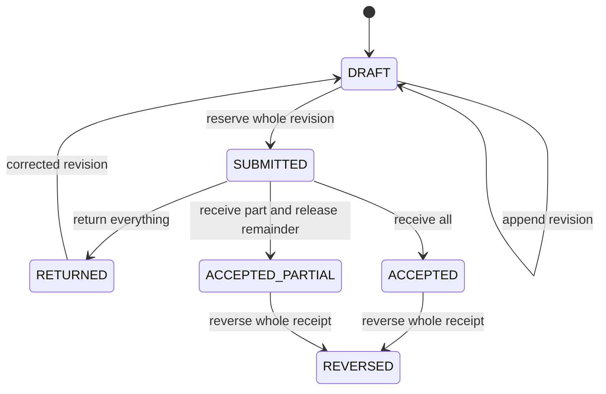

# Contract Execution Ledger

English · [Português (Brasil)](README.pt-BR.md)

A Python SDK and local HTTP API for authorized quantities, submitted measurements,
partial receipts, returns and reversals. Synthetic service contracts exercise real
SQLite transactions and server-resolved permissions. This project demonstrates
persisted administrative workflow development; it claims no customer, government
adoption or certification.

```sh
sh scripts/check.sh
# With the genuine wheel installed in a Python 3.13 environment:
execucao-contratual-ledger demo --assert
```

The check builds a genuine sdist/wheel, rebuilds the wheel from the sdist, installs
it into a fresh prefix outside the checkout, and runs SDK, real HTTP and CLI tests.
A separate runtime container consumes the installed artifact. Preparation can
retrieve five exact hash-locked build wheels from PyPI; validation uses no external
network, UID1000, dropped capabilities, no-new-privileges,1GiB/2CPU and a read-only
root filesystem. Docker and Python3 are required for orchestration.
`--wheelhouse DIRECTORY` reuses the five verified cached wheels.

## Demonstrated workflow

Start with100 units, reserve70, receive60, release the complete reservation and
leave40 available. The demo exercises return/revision, ceiling amendments, reversal,
two concurrent submissions, permission refusals and reopening. Its final balance
is90 authorized,0 reserved,0 received and90 available, with14 events/operations.

A real TCP client sends an amendment, observes its commit independently and discards
the unread response. An exact retry returns the original receipt without another
event. The server may have successfully buffered the response; this does not claim
that sendall failed or native COMMIT raised. Demo invariants are always active;
`--assert` makes that explicit for validation commands.



## SDK

```python
from execucao_contratual_ledger import ActorSpec, ItemSpec, Ledger, Principal, Role

actors = (
    ActorSpec("manager", (Role.MANAGER,)),
    ActorSpec("requester", (Role.SUBMITTER,)),
    ActorSpec("inspector", (Role.RECEIVER,)),
)
ledger = Ledger.create("new.sqlite", actors)
try:
    result = ledger.create_contract(
        principal=Principal("manager"), contract_id="contract_a",
        operation_id="create_a", expected_version=0,
        items=(ItemSpec("hours", "hour", 1000, 100000),),
        member_ids=("manager", "requester", "inspector"),
    )
    print(result.receipt.committed_version)  # 1
finally:
    ledger.close()
```

The host authenticates Principal before calling the SDK; an identifier alone is
not authentication. CLI `--actor` is a trusted local operator selecting an explicit
database. HTTP uses fresh256-bit synthetic secrets resolved on the server and held
in the owning harness memory; identity/role fields in command JSON are rejected.
See the [HTTP/CLI API](docs/API.md) and [consistency contract](docs/CONTRACT.md).

## Rules and bounds

Quantities are strict integer ticks. Each item retains its unit and scale1 or1000,
without automatic conversion or totals across unlike units:
`available = authorized - reserved - received`, always nonnegative.

Managers amend/reverse; submitters write their own measurements; receivers decide;
auditors read. Combined roles use a capability union. A submitter cannot decide
its own revision; a reversing manager must differ from both submitter and receiver.
Previous facts remain retained.

Defaults/hard maxima:32 actors,32 contracts,16 items/contract,256 measurements,
8 revisions/measurement,4096 global events. Smaller/zero quotas are valid policy;
retained terminal records do not free quota. IDs are ASCII, quantities<=10^12,
reasons<=256UTF8bytes. Raw read materialization<=1MiB; history pages<=100 events use
an explicit version anchor. CLI input is bounded to65536bytes and requires EOF;
a nonblocking None read is an IO refusal before parsing/dispatch.

BEGIN IMMEDIATE serializes writers. CAS, operation identity and facts share the
same transaction. An exact retry returns the receipt from its original commit,
even after current balances change. Changed content under the same key conflicts.
NO_EFFECT requires established rollback/non-dispatch. UNKNOWN requires reopening
and reconciling the same operation ID, without assuming rollback.

Qualified runtime: actual CPython3.13.18/SQLite3.40.1, with STRICT/FK/constraints;
this is not a claim about the latest SQLite release. Logical bounds do not cap all
native allocations on hostile database files; qualification uses a controlled,
confined environment. The console and Python-I module entrypoints are separately
tested; arbitrary sitecustomize/PYTHONPATH/preloaded extensions are outside it.

Scope is quantities and administrative facts asserted by actors. Pricing, payments,
taxes, legal signatures, physical verification, statutory amendment rules, PNCP
writes and production operation are outside the contract.

[Provenance](PROVENANCE.md) · [Actual dependencies/notices](THIRD_PARTY_NOTICES.md)
