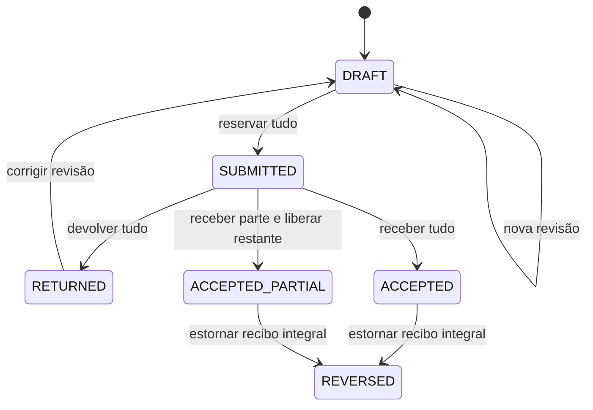

# Execução Contratual Ledger

[English](README.md) · Português (Brasil)

SDK Python e API HTTP local para acompanhar quantidades autorizadas, medições
submetidas, recebimentos parciais, devoluções e estornos. O exemplo usa contratos
de serviços sintéticos, SQLite com transações reais e permissões resolvidas no
servidor. Serve para demonstrar desenvolvimento de fluxos administrativos
persistidos; não apresenta clientes, adoção governamental ou certificação.

```sh
sh scripts/check.sh
# ou, em um ambiente Python 3.13 com o wheel instalado:
execucao-contratual-ledger demo --assert
```

O check constrói sdist e wheel, reconstrói o wheel a partir do sdist, instala em
prefixo novo fora do checkout e executa testes do SDK, HTTP real e CLI. Um segundo
contêiner consome somente o artefato instalado. Preparação pode acessar PyPI para
cinco wheels de build com hashes fixos; validação usa rede externa desabilitada,
UID 1000, capabilities removidas, no-new-privileges, limite de 1 GiB/2 CPUs e
filesystem raiz somente leitura. Requisitos: Docker e Python 3 para orquestração.
`--wheelhouse DIRETORIO` reutiliza os cinco wheels existentes e verificados.

## Fluxo demonstrado

A demonstração cria um contrato com 100 unidades, reserva 70 e recebe 60,
liberando integralmente a reserva e deixando 40 disponíveis. Exercita devolução,
revisão, redução de teto, estorno, duas submissões concorrentes, negação de
permissões e reabertura. O saldo final é 90 autorizadas, zero reservadas,
zero recebidas e 90 disponíveis; há 14 eventos e 14 operações.

Uma conexão TCP envia uma alteração, observa seu commit por leitura independente
e descarta a resposta sem consumir bytes. A repetição exata recebe o recibo
original sem novo evento. O servidor pode ter enviado a resposta ao buffer TCP;
essa prova não afirma falha de `sendall` nem erro nativo de COMMIT.



## SDK

```python
from execucao_contratual_ledger import ActorSpec, ItemSpec, Ledger, Principal, Role

actors = (
    ActorSpec("gestor", (Role.MANAGER,)),
    ActorSpec("solicitante", (Role.SUBMITTER,)),
    ActorSpec("fiscal", (Role.RECEIVER,)),
)
ledger = Ledger.create("novo.sqlite", actors)
try:
    outcome = ledger.create_contract(
        principal=Principal("gestor"), contract_id="contrato_a",
        operation_id="criar_a", expected_version=0,
        items=(ItemSpec("horas", "hora", 1000, 100000),),
        member_ids=("gestor", "solicitante", "fiscal"),
    )
    print(outcome.receipt.committed_version)  # 1
finally:
    ledger.close()
```

O host autentica `Principal` antes de usar o SDK. Um identificador não autentica
ninguém. O CLI `--actor` é operação local confiável sobre um arquivo explicitamente
escolhido. A API HTTP usa tokens sintéticos de 256 bits gerados com `secrets`,
resolvidos no servidor e mantidos na memória do harness; campos de identidade ou
papéis em JSON de comandos são recusados. Veja [API](docs/API.md).

## Regras e limites

Quantidades são inteiros em ticks; cada item mantém unidade e escala 1 ou 1000.
Não há conversão automática ou soma de unidades diferentes. Para cada item:
`disponível = autorizado - reservado - recebido`, sempre não negativo.

O gestor altera tetos e estorna; solicitantes escrevem somente medições próprias;
fiscais recebem/devolvem; auditores leem. Papéis combinados usam união de
capacidades. Ninguém recebe a própria submissão, e o gestor que estorna deve ser
diferente de quem submeteu e de quem recebeu. Fatos anteriores permanecem.

Defaults e máximos: 32 atores, 32 contratos, 16 itens por contrato, 256 medições,
8 revisões por medição e 4096 eventos globais. Reduções, inclusive zero, são
política válida; não há crédito de quota por documentos terminados. IDs são ASCII,
quantidades vão até 10¹², motivos até 256 bytes UTF-8. Leituras materializam no
máximo 1 MiB; histórico paginado até 100 eventos usa âncora de versão explícita.

SQLite serializa escritas com `BEGIN IMMEDIATE`; CAS e identidade de operação são
verificados dentro da transação. Repetição exata retorna o recibo do commit
original, mesmo que o saldo atual tenha avançado. Reutilizar a chave com outro
conteúdo conflita. Antes de um erro com `NO_EFFECT`, rollback/não despacho precisa
estar estabelecido. `UNKNOWN` exige reabrir e reconciliar a mesma operação; não
significa saldo negativo nem autoriza presumir rollback.

Runtime qualificado: CPython 3.13.18/SQLite 3.40.1 efetivamente observados, com
`STRICT`, chaves estrangeiras e constraints. Não é uma afirmação sobre a versão
mais recente de SQLite. Limites lógicos não limitam todas as alocações internas do
parser nativo sobre arquivos hostis; o ambiente é controlado e confinado.

Escopo: quantidades e fatos administrativos declarados pelos atores. Preços,
pagamentos, tributos, assinatura legal, verificação física do serviço, regras
jurídicas de aditivo, PNCP de escrita e operação em produção ficam fora do contrato.

[Contrato e erros](docs/CONTRACT.md) · [Proveniência](PROVENANCE.md) ·
[Dependências e avisos](THIRD_PARTY_NOTICES.md)
